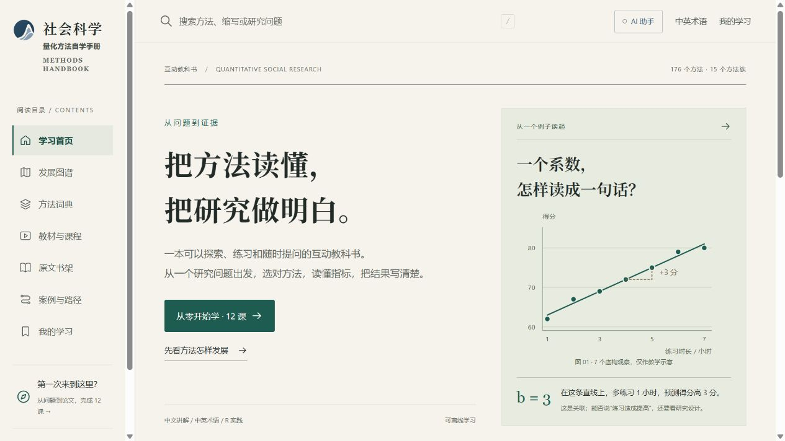
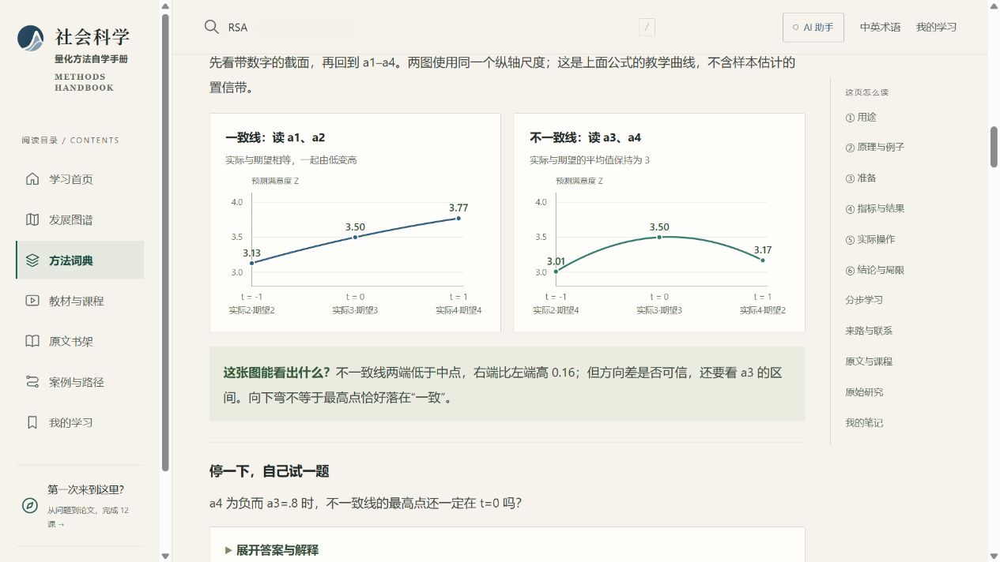
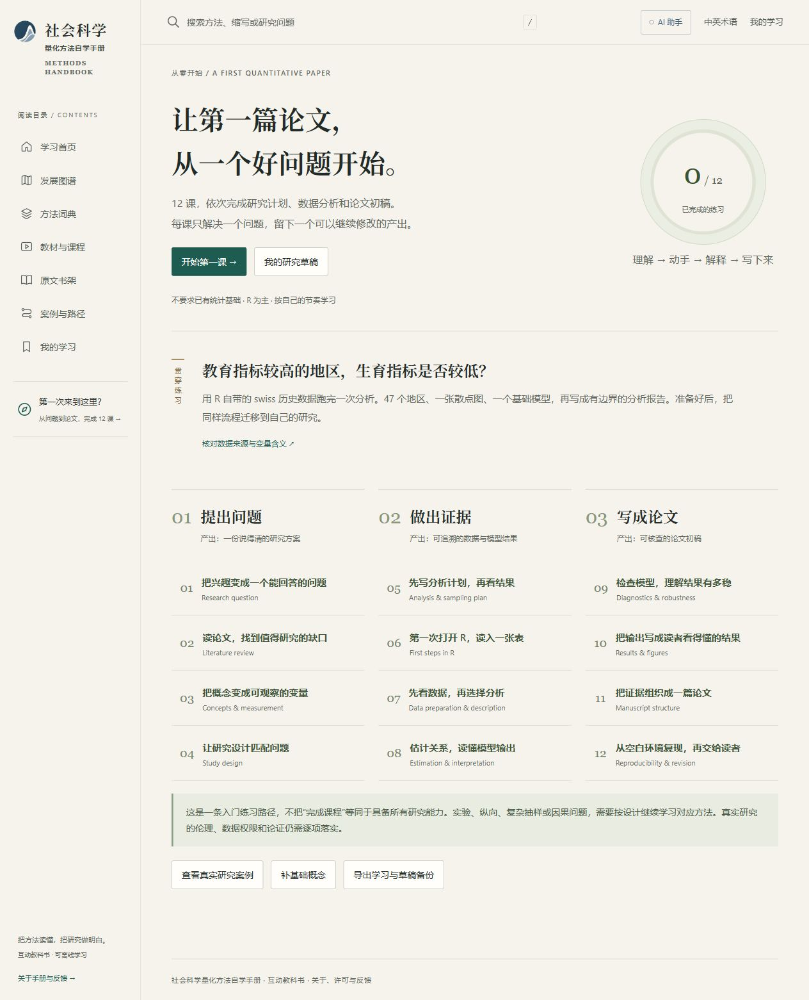
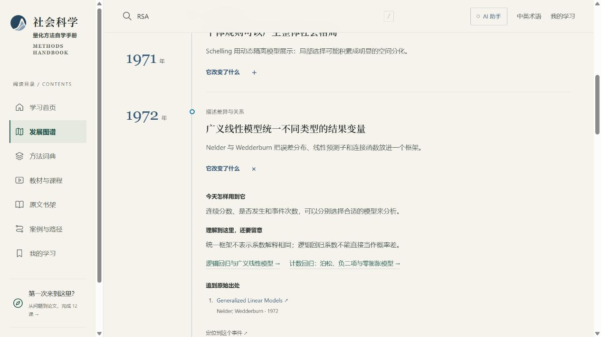
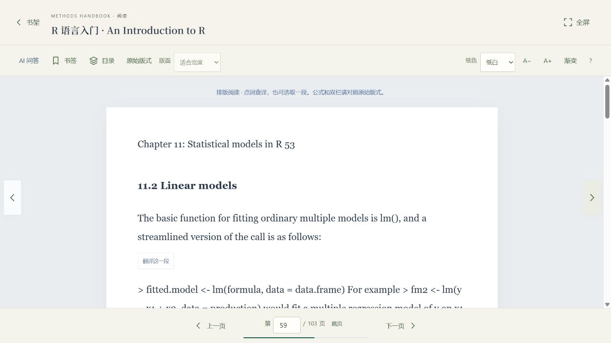
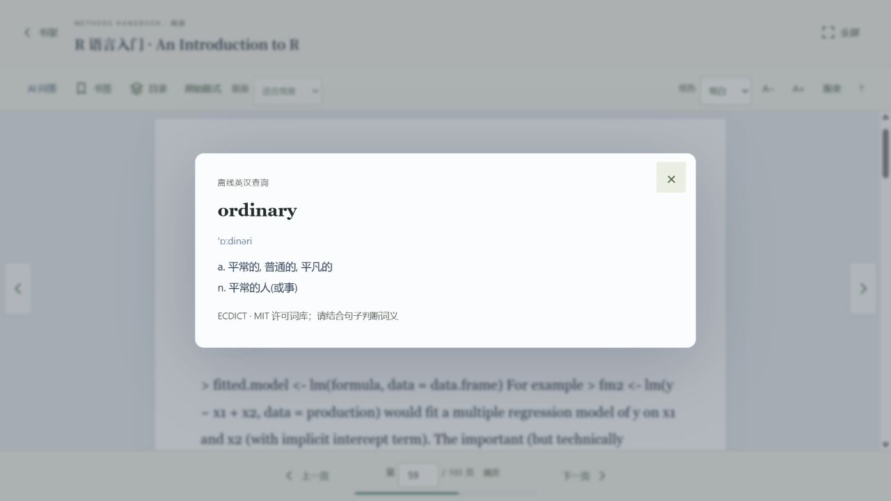
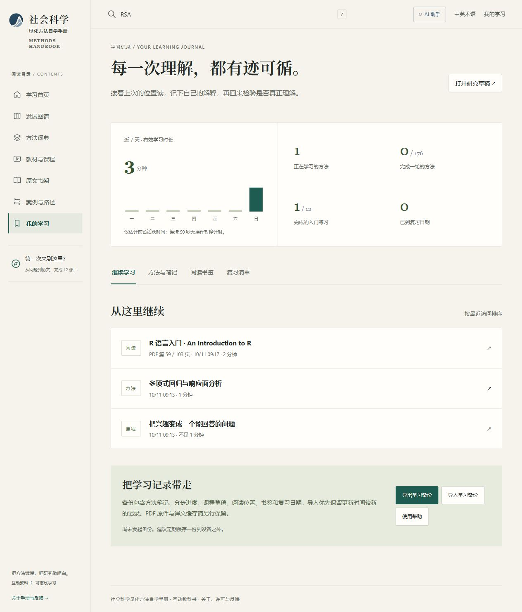

# 社会科学量化方法自学手册

An Interactive Self-Study Handbook of Quantitative Methods for the Social Sciences

**从零学方法，读懂统计结果，一步步练习写量化论文。**

一本可以查方法、看图解、读原文、做练习、记笔记的互动教科书。

Windows 10 / 11 x64 · 中文讲解与英文术语对照 · R 示例为主 · 核心内容可离线使用

[下载使用](#下载使用) · [看看怎么用](#看看怎么用) · [提出建议](https://github.com/RaytonXia/social-science-quantitative-methods-handbook/issues/new/choose) · [使用说明](使用说明.txt)

## 这是什么

如果你正在学社会科学量化研究，可能会遇到这些问题：**研究该用什么方法？软件输出的一堆数字怎么看？看完教材，还是不知道怎么开始做研究？**

这本手册把方法讲解、结果示例、原始文献和学习练习放在一起。你可以按课程顺序学，也可以带着一个具体问题进来查。遇到不懂的术语，点开解释；想知道方法之间的关系，展开分类树；读到需要核对的地方，打开配套原文。

目前包含 **176 个方法与基础条目、12 课入门引导、89 个方法史事件和 63 份离线原文**。讲解以中文为主，配专业英文名称；代码示例以 R 为主，兼顾其他软件。

## 下载使用

直接点击下表中的文件名下载，选一种即可。也可以到[最新版下载页](https://github.com/RaytonXia/social-science-quantitative-methods-handbook/releases/latest)的 **Assets** 中下载。

| 你想怎么用 | 下载哪个文件 | 下载后怎么打开 |
| --- | --- | --- |
| 安装到电脑上，**推荐初次使用** | [QuantMethodsHandbook_v1.0.2_Setup.exe](https://github.com/RaytonXia/social-science-quantitative-methods-handbook/releases/download/v1.0.2/QuantMethodsHandbook_v1.0.2_Setup.exe) | 双击安装，完成后从开始菜单打开手册。 |
| 不安装，解压就用 | [QuantMethodsHandbook_v1.0.2.zip](https://github.com/RaytonXia/social-science-quantitative-methods-handbook/releases/download/v1.0.2/QuantMethodsHandbook_v1.0.2.zip) | **完整解压**，进入解压后的文件夹，双击 `社会科学量化方法自学手册_v1.0.2.exe`。 |

**不要只拿走 EXE，也不要在压缩包里直接运行。** 旁边的 `app` 文件夹、DLL 和配置文件都要保留。GitHub 的 **Source code** 是维护源码，初次使用不用下载它。

当前版本为 **v1.0.2**，支持 Windows 10 / 11 **64 位**，需要 .NET Framework 4.6.2 或更高版本及 Microsoft Edge WebView2 Runtime。缺少 WebView2 时，安装向导会提示联网安装微软组件；已有组件时可以离线安装。安装包目前没有代码签名。Android 版尚未同步本版，因此这里暂不提供 APK。

第一次打开，点首页的 **“从零开始”**。已经有具体问题，就进 **“方法词典”** 搜索。下载页的 `SHA256_v1.0.2.txt` 可用于核对文件是否完整；测试范围见[发行检查记录](https://github.com/RaytonXia/social-science-quantitative-methods-handbook/blob/main/docs/RELEASE_CHECKS.md)。

## 看看怎么用

以下图片来自实际运行的应用；学习记录使用演示内容。

### 1. 查方法，弄懂结果里的数字

在“方法词典”里输入中文名、英文名或缩写，也可以按研究问题、方法族、难度和软件筛选。

打开一个方法，按六个问题往下看：**它解决什么问题 → 原理怎么理解 → 需要什么数据和条件 → 结果先看哪些指标 → 实际怎么做 → 能得出什么结论、有哪些局限。**

例如，学习响应面分析（RSA）时，可以对照数值和图形理解 **a1、a2、a3、a4**：它们分别表示什么，正负号怎么读，哪些情况下还不能据此下结论。结果表会指出该看哪个数，并解释这个数的变化意味着什么。

### 2. 不知道从哪开始，就跟着做一项研究

“从零开始”分成 12 课，带你确定研究问题、找文献、定义变量、设计研究、安排样本、分析数据，再整理成论文草稿。每课都有具体任务，你可以边学边填写自己的想法，下次接着做。

另有“入门论文练习”，用 R 自带的数据走一遍分析过程。**手册提供讲解与代码，不在应用里运行 R**；运行示例需要使用自己的 R 环境。

### 3. 看方法从哪里来，和其他方法有什么关系

“发展脉络”把 **1662—2026 年的 89 个事件**放到时间线上。可以按年代、主题和关键词查找，展开事件后查看它解决了什么问题、带来了什么变化，以及相关方法和原始文献。

想先看全貌，就切换到方法分类树；想深入某个方法，可以直接点进词典继续读。

### 4. 直接读原文，遇到英文就查词

“原文书架”内置 **63 份教材、论文和参考手册**，可以离线阅读。阅读器支持全屏、目录、页码跳转、左右点击翻页、书签和阅读位置记忆。

英文单词可以**离线查中文释义**；选中一段文字后，可以确认联网翻译。觉得原始 PDF 排版不方便时，可以切换“排版阅读”。扫描图片和复杂公式的文字提取可能不完整，需要对照原件。

另有 **10 份读物提供官方获取入口**。你取得文件后，可以导入本机阅读。方法页还列有中英文教材、文档和视频课程入口；这些外部资源需要联网，部分需要登录或订阅。

点开看离线查词示例

### 5. 记住学到哪里，把自己的理解留下来

在方法页收藏、做笔记、标记学习状态，再到“我的学习”查看学习进度和复习安排。课程草稿也会保留，方便继续写。

换电脑或清理设备前，在“我的学习”**导出备份**；到新设备后再导入。自行导入的 PDF 原件需要另存一份，不包含在学习记录备份里。

### 6. 有疑问时，可以手动开启 AI 助手

点击顶端的“AI 助手”，开启后选择 **DeepSeek、OpenAI、Claude 或 Gemini**，填入自己的 API Key 和模型名称，就能围绕不懂的内容继续问。也可以主动勾选，把当前方法的教学说明附给助手。

**AI 默认关闭，不影响离线学习。** 本项目不提供共享密钥；调用可能产生服务商费用。AI 回答适合帮助理解，统计结论和引用仍要对照原始文献核实。

## 记录和隐私

| 内容 | 保存或发送到哪里 |
| --- | --- |
| 学习记录、笔记、收藏和课程草稿 | 保存在本机。Windows 位置为 `%LOCALAPPDATA%/MethodAtlas/WebView`，卸载保留这些记录。 |
| 离线查词 | 查询本地词典，不需要联网。 |
| 段落翻译 | 确认后，把**选中的文字**发送给 MyMemory，不会整份上传 PDF。 |
| AI 问答 | 只有主动发送问题或读取模型列表时才连接所选服务商。不会自动发送笔记、阅读历史或导入文件。 |
| API Key 与 AI 对话 | 只保留在本次运行的内存中；关闭助手或退出应用后清除，不写入学习记录备份。 |

## 为什么做这本手册

这个项目最初是为了帮助作者自学**社会心理学的量化研究方法**。学习中常常遇到同一个困难：找得到资料，却不容易把研究问题、方法和结果解释连起来。因此，我们希望把这段学习过程做得更直观，也让更多老师、同学和独立学习者用得上。

欢迎大家帮助它继续更新。**讲解太绕、指标没讲清、术语不准确、链接打不开，或有更好的教材与案例，都可以提出来。** 不要求会写代码：在 [Issues](https://github.com/RaytonXia/social-science-quantitative-methods-handbook/issues/new/choose) 选择“内容纠错与教学建议”或“软件问题”，写清位置、问题和参考来源即可。请不要附上私人研究数据或 API 密钥。

想添加方法，可以从应用的 **“方法词典 → 添加方法”**进入。这里有模板、校验工具和可以交给后续 AI 的维护说明；完整规范见 [贡献指南](CONTRIBUTING.md)。

## 许可

**未经作者事先书面同意，不得将项目自有代码或原创教学内容用于商业目的。**

- 自有代码允许署名后非商业使用、修改和再分发，具体见 [代码许可](LICENSE)。这是提供源码的非商业项目，不是采用 OSI 开源许可的项目。
- 原创教学内容采用 [CC BY-NC 4.0](LICENSE-CONTENT.md)。
- 第三方文献、词典、字体和组件保留各自许可；本项目的非商业条款不限制第三方许可已经授予的权利。

内置原文保留完整文件与版权声明；28 份 R 包参考手册附有对应版本源码。逐项依据见 [第三方许可说明](docs/THIRD_PARTY.md)、[读物清单](docs/third-party-readings.csv)及[官方获取清单](docs/OFFICIAL_DOWNLOADS.md)。

## 维护与构建

网页和教学数据在 `app/`；PDF 与 R 包源码随 Release 提供。内容校验命令为 `python app/contribute/method_tool.py check-app`，预览和打包步骤见 [构建说明](docs/BUILD.md)。

仓库提供启动器与 AI 连接组件源码。既有的 `Atlas.Shell.dll` 目前只有编译文件，因此暂时不能从仓库源码重建全部原生外壳。

## English overview

An interactive textbook for beginners learning quantitative research in the social sciences. Find a method, understand its output through worked examples, follow a 12-lesson research-writing course, explore the history of methods, read original sources, and keep study notes.

Originally created for the author's self-study in social psychology. The Windows app includes 176 method and foundation entries, 89 historical events, and 63 offline readings. Teaching is primarily in Chinese, with English terminology and R-oriented examples; R code runs in your own R environment. Optional AI assistance uses your own API account. Suggestions from teachers and students are welcome. Project-owned code and teaching content are for noncommercial use; third-party works retain their own licenses.
